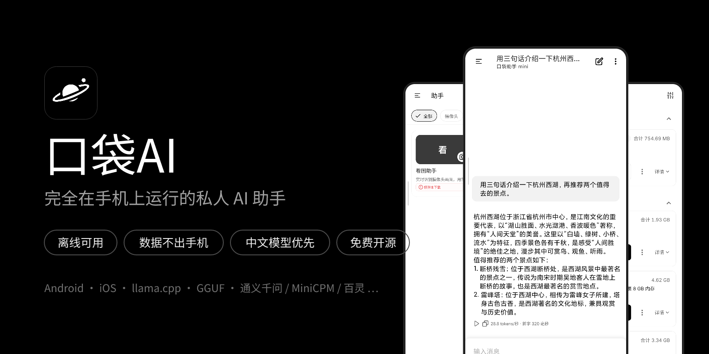
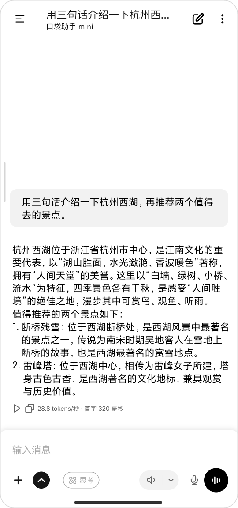
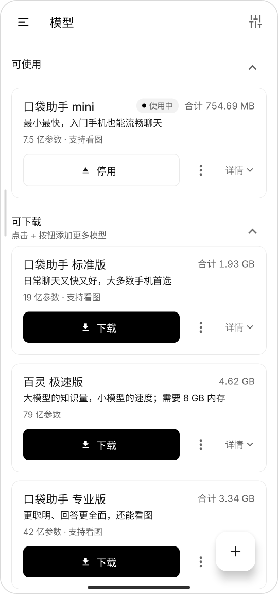
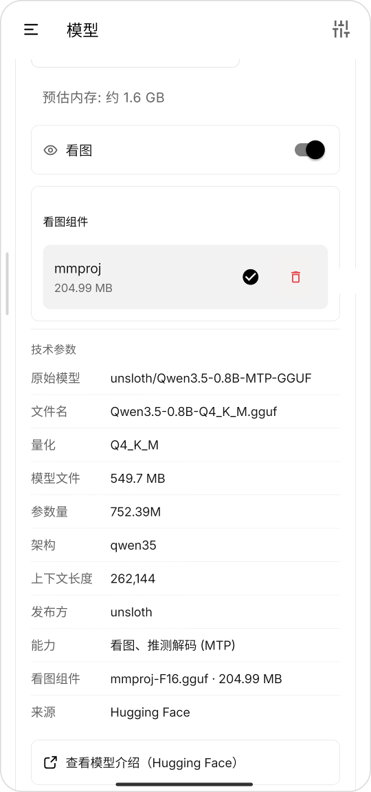
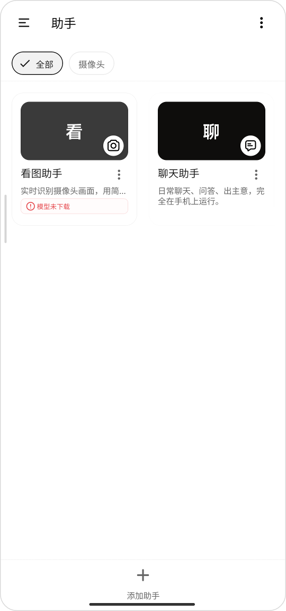
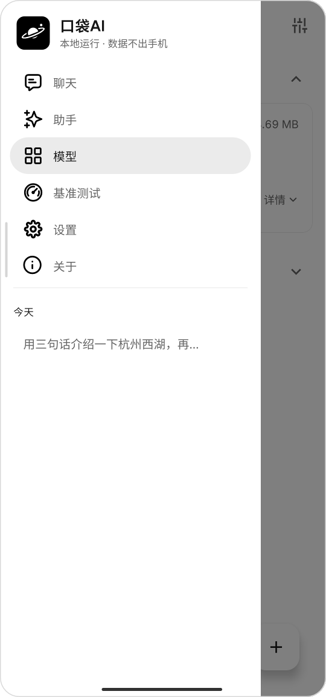
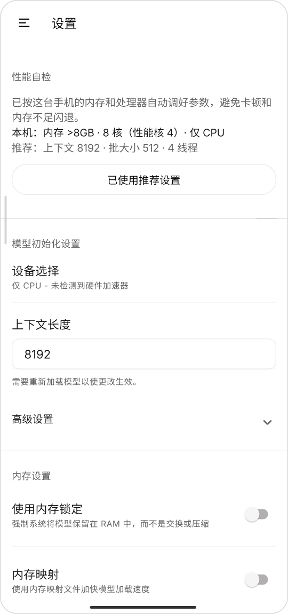
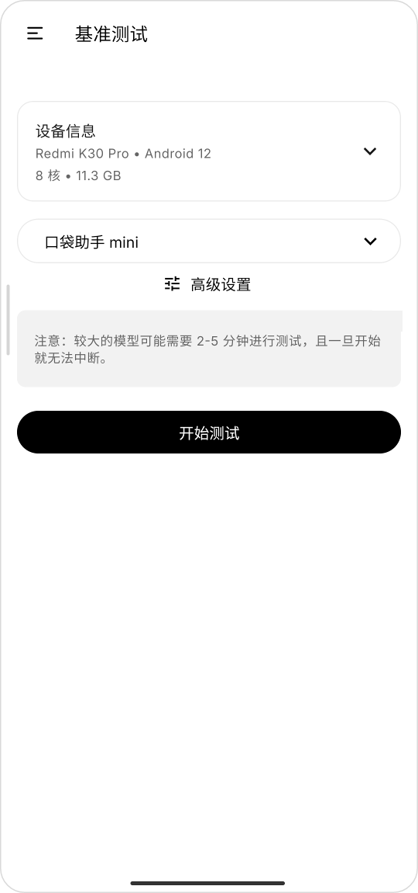
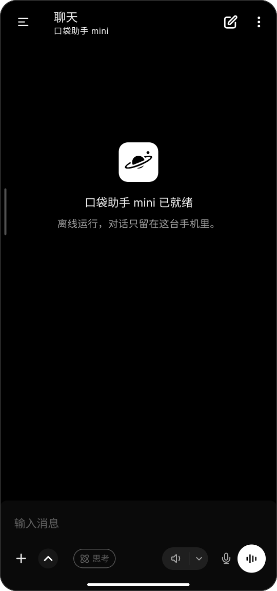

<div align="center">



# PocketWisdom (口袋AI) · Offline LLM chat app for Android & iOS

**Run local LLMs on your phone · Works offline · Chats never leave the device · Free and open source**

[](https://github.com/yzfly/pocketpal-ai-zh/stargazers)
[](./LICENSE)
[](#install)
[](https://github.com/ggml-org/llama.cpp)
[](https://github.com/a-ghorbani/pocketpal-ai)

[Screenshots](#screenshots) · [What's different](#whats-different-from-upstream) · [Features](#features) · [Install](#install) · [FAQ](#faq) · [简体中文](./README.md)

</div>

---

**PocketWisdom** (口袋AI) is an open-source mobile app that runs GGUF language models such as Qwen, MiniCPM and Ling directly on your Android or iOS phone with [llama.cpp](https://github.com/ggml-org/llama.cpp). No server, no internet connection and no account are needed. It is the Chinese-focused fork of [PocketPal AI](https://github.com/a-ghorbani/pocketpal-ai), tuned for users in mainland China and for Chinese-language models.

- **Offline**: download a model once, then chat, ask about images and talk to it in airplane mode
- **Private**: conversations, images and voice are processed on the device only
- **Practical**: a ~0.5 GB model generates about 27 tokens/s on a 2020 Snapdragon 865 phone

## Screenshots

<table>
  <tr>
    <td align="center" width="25%"><br/><sub><b>Offline chat</b></sub></td>
    <td align="center" width="25%"><br/><sub><b>Models</b></sub></td>
    <td align="center" width="25%"><br/><sub><b>Model details</b></sub></td>
    <td align="center" width="25%"><br/><sub><b>Assistants</b></sub></td>
  </tr>
  <tr>
    <td align="center"><br/><sub><b>History &amp; navigation</b></sub></td>
    <td align="center"><br/><sub><b>Device check</b></sub></td>
    <td align="center"><br/><sub><b>Benchmark</b></sub></td>
    <td align="center"><br/><sub><b>Dark mode</b></sub></td>
  </tr>
</table>

The interface is Simplified Chinese by default; Traditional Chinese, English and 10+ other languages can be selected in Settings.

## What's different from upstream

- **Hugging Face mirror built in**: model, speech-recognition and voice downloads go through [hf-mirror.com](https://hf-mirror.com) and fall back to ModelScope, so they work in mainland China without a VPN. The HF token is never sent to the mirror.
- **Chinese models first**: the recommended list is led by open models from Chinese teams (Qwen, MiniCPM, Ling, MiMo, Hunyuan-MT and others), ordered by measured on-phone speed and quality.
- **Plain-language model names**: models are named by purpose (mini / standard / pro / flagship) with a one-line description, so users do not need to know quantization or parameter counts.
- **Newer inference engine**: llama.cpp v0.9.0, with Hexagon NPU and OpenCL libraries rebuilt to match.
- **Device check**: context size, batch size and threads are set from the phone's memory and performance cores on first launch; a crashed load halves them on the next start.
- **Chinese text-to-speech**: an on-device Kokoro Chinese voice engine (4 female and 4 male voices).
- **Optional account that works in China**: email and password sign-in through Supabase Auth. Signing in is optional.
- **In-app updates**: the app checks a manifest on launch, then downloads, verifies and installs the new APK.
- **Black-and-white minimal UI**, and one logo for the launcher icon and every in-app surface.
- **Local only**: the upstream PalsHub marketplace and paid Plus features are removed. Everything is free.

## Features

| Feature | Notes |
|---------|-------|
| Offline chat | All inference on device; background downloads, automatic load/unload, live tokens/s and time to first token |
| Vision | Use multimodal models to ask about photos, read documents and extract text |
| Assistants | Built-in chat, coding, study, role-play, writing and vision assistants, plus your own system prompts |
| Voice input and hands-free voice chat | On-device Whisper, fully offline |
| Text-to-speech | Several on-device voice engines |
| Tool calling | Web search, read URL, calculator, date/time and HTML preview |
| Local API server | Serve the phone's model over an OpenAI-compatible API on your LAN |
| Hardware acceleration | Qualcomm Hexagon NPU (Snapdragon 8 Gen 2 and newer) when available, with automatic CPU fallback |
| Benchmark | Measure your device and optionally submit to the [leaderboard](https://pocketpal.dev/leaderboard) |

The recommended model table with measured speeds is in the [Chinese README](./README.md#-内置推荐模型).

## Install

- **Android**: download the latest APK from [Releases](https://github.com/yzfly/pocketpal-ai-zh/releases/latest) (package `com.pocketwisdom`, installs alongside upstream PocketPal). Uninstall versions 1.6.9 and older first, because the signing key changed.
- **iOS**: build with Xcode.

Getting started: open the app → download "口袋助手 mini" (about 0.5 GB) on the Models page → tap Load and start chatting.

## FAQ

**Can a phone really run an LLM?**
Yes. The default 0.8B model runs smoothly on entry-level phones; phones with more memory can run 2B, 4B or 9B models. The app recommends models and sets parameters based on the device.

**Does it need internet or an account?**
Only to download models. Chat, vision and voice run offline, and signing in is optional.

**Which models are supported?**
Any GGUF model that llama.cpp can run. Search Hugging Face from the Models page or import a local file.

**Are my chats uploaded?**
No. Conversations are stored on the phone. Only if you turn on the web-search tool is the search query sent to the search provider you choose.

## Development

```bash
git clone https://github.com/yzfly/pocketpal-ai-zh.git
cd pocketpal-ai-zh
yarn install
cp .env.example .env   # account relay URL, Supabase publishable key, update manifest URL (do not commit)

# iOS
cd ios && pod install && cd ..
yarn ios

# Android
yarn android
```

Before opening a pull request, run `yarn lint`, `yarn typecheck` and `yarn test`. The launcher icons and the in-app logo are generated from `scripts/app-icon/*.svg` with `yarn icons:generate`. More developer documentation is in the upstream [development guide](https://github.com/a-ghorbani/pocketpal-ai#development-setup).

## Acknowledgements

- [a-ghorbani/pocketpal-ai](https://github.com/a-ghorbani/pocketpal-ai): all core capabilities come from upstream and its community
- [llama.cpp](https://github.com/ggml-org/llama.cpp) and [llama.rn](https://github.com/mybigday/llama.rn)
- [hf-mirror.com](https://hf-mirror.com) for the mirror service
- The teams behind the open models: [Qwen](https://github.com/QwenLM), [OpenBMB](https://github.com/OpenBMB), [inclusionAI](https://huggingface.co/inclusionAI), [Xiaomi MiMo](https://huggingface.co/XiaomiMiMo), [Tencent Hunyuan](https://huggingface.co/tencent) and others

## Author

**云中江树** · GitHub [@yzfly](https://github.com/yzfly)

## License

[MIT](./LICENSE), following upstream.
